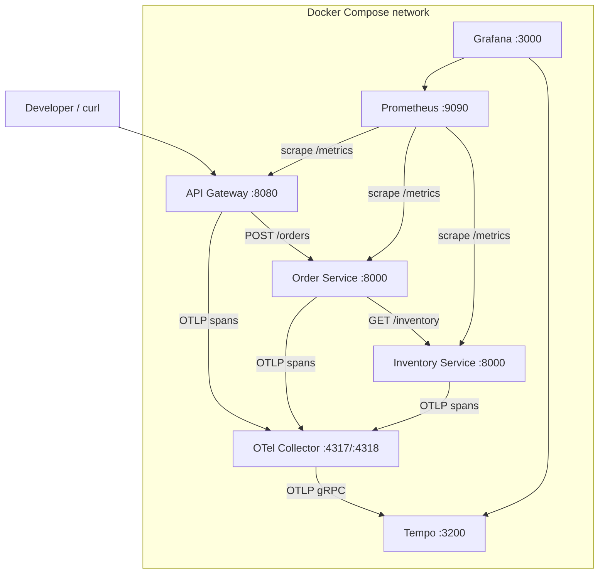
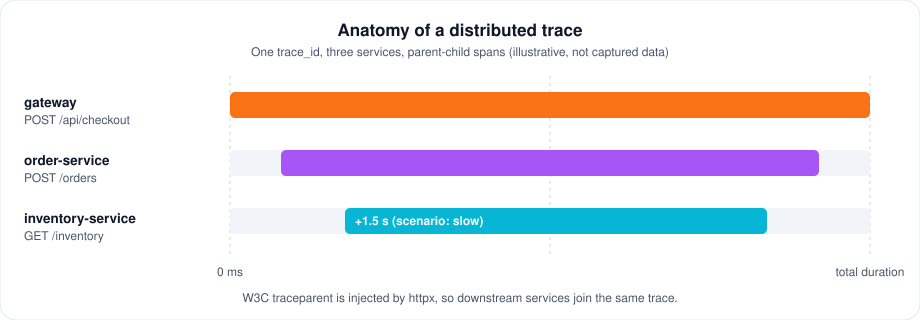

<a id="readme-top"></a>

<div align="center">

<picture>
  <source media="(prefers-color-scheme: light)" srcset="assets/traceforge-wordmark-light.svg">
  
</picture>

**See the journey of a request: traces, metrics and correlated logs across three Python microservices.**

[Architecture](#architecture) · [Setup](#local-setup-powershell) · [Scenarios](#demo-scenarios) · [Traces](#how-to-inspect-traces-in-grafana) · [Slow requests](#how-to-investigate-a-slow-request) · [Alerts](#how-to-trigger-and-verify-alerts) · [Limitations](#known-limitations) · [Deutsch](#kurzbeschreibung-deutsch)

</div>

# TraceForge

Local OpenTelemetry observability platform demonstrating how to investigate slow
requests, service failures and correlated logs across three Python microservices.
Built as a portfolio project for a **Fachinformatiker für Anwendungsentwicklung**
Ausbildung application.


## At a glance

| | |
| --- | --- |
| 🧭 **Follow one request** | W3C `traceparent` propagation joins gateway, order and inventory into a single trace. |
| 🔗 **Logs that correlate** | JSON logs carry `trace_id` / `span_id`; without trace context they are `null`, never faked. |
| 📈 **Bounded-cardinality metrics** | Prometheus counters and histograms with a limited label set, scraped every 5 s. |
| 🎭 **Deterministic faults** | Seven reproducible scenarios (slow, error, exception, unavailable, …) instead of random chaos. |
| 🚨 **Alert rules** | Latency and threshold alerts evaluated by Prometheus (no notification channel by design). |
| 🧪 **Tested for real** | 44 unit + 3 integration tests using real uvicorn processes and real OTLP over TCP. |

> [!NOTE]
> The Docker Compose stack (Tempo, Prometheus, Grafana, alerts) is configured but **not verified** in the build environment. See [Known limitations](#known-limitations).

<details>
<summary><strong>Table of contents</strong></summary>

1. [Problem statement](#problem-statement)
2. [Architecture](#architecture)
3. [Technology stack](#technology-stack-all-versions-verified-against-real-registries-2026-10-19)
4. [Telemetry data flow](#telemetry-data-flow)
5. [Service responsibilities](#service-responsibilities)
6. [Local setup](#local-setup-powershell)
7. [Configuration reference](#configuration-reference)
8. [Demo scenarios](#demo-scenarios)
9. [Inspect traces in Grafana](#how-to-inspect-traces-in-grafana)
10. [Investigate a slow request](#how-to-investigate-a-slow-request)
11. [Inspect correlated logs](#how-to-inspect-correlated-logs)
12. [Query Prometheus metrics](#how-to-query-prometheus-metrics)
13. [Trigger and verify alerts](#how-to-trigger-and-verify-alerts)
14. [Testing](#testing)
15. [Security considerations](#security-considerations)
16. [Known limitations](#known-limitations)
17. [Troubleshooting](#troubleshooting)
18. [Future improvements](#future-improvements)
19. [Kurzbeschreibung (Deutsch)](#kurzbeschreibung-deutsch)

</details>

## Problem statement

When a request spans multiple services, "it's slow" or "it returned 500" is not
actionable. You need to see the *journey*: which hop failed, how long each hop
took, and which log lines belong to which request. TraceForge demonstrates the
complete telemetry path — instrumentation → OTLP → trace backend → dashboards —
with deterministic, reproducible fault scenarios instead of random chaos.

## Architecture



<div align="center">
  
  <p><em>What you will see in Tempo: one trace, three services (illustrative diagram).</em></p>
</div>

## Technology stack (all versions verified against real registries 2026-10-19)

| Component | Version | Source |
|---|---|---|
| Python | 3.12-slim image / 3.12.3 local | Docker Hub `library/python` |
| FastAPI / uvicorn | 0.141.1 / 0.54.0 | PyPI `pip index versions` |
| OpenTelemetry SDK / API | 1.39.1 | PyPI |
| otel instrumentation (fastapi, httpx) | 0.60b1 | PyPI (release-train pairing with 1.39.x) |
| OpenTelemetry Collector | otel/opentelemetry-collector:0.139.0 | Docker Hub tag query |
| Grafana Tempo | 3.1.0 | Docker Hub + GitHub releases |
| Prometheus | v3.13.4 | Docker Hub + GitHub releases |
| Grafana | 12.1.4 | Docker Hub + GitHub releases |
| pytest / ruff / mypy | 9.1.1 / 0.17.1 / 2.4.0 | PyPI |

## Telemetry data flow

1. Client → Gateway (SERVER span). Business spans add domain context.
2. Instrumented httpx calls inject W3C `traceparent`; downstream services **join the same trace** (verified by integration tests over real TCP).
3. Spans batch-export via OTLP/HTTP → Collector → OTLP/gRPC → Tempo (parquet, 24 h retention).
4. Prometheus scrapes `/metrics` (bounded-label counters/histograms) every 5 s.
5. Structured JSON logs on stdout carry `trace_id`/`span_id`.

## Service responsibilities

- **gateway** — only internet-facing service; `POST /api/checkout`, `GET /api/inventory-lookup`
- **order-service** — business operation; hops to inventory so traces cross real process boundaries
- **inventory-service** — downstream dependency; hosts deterministic fault scenarios

## Local setup (PowerShell)

```powershell
git clone <your-repo-url> traceforge; cd traceforge
Copy-Item .env.example .env
python -m venv .venv; .\.venv\Scripts\Activate.ps1
pip install -r requirements.txt
pytest tests -q                                   # 47 tests, no Docker needed
docker compose up -d --build                      # full stack
docker compose ps                                 # wait for healthy
curl http://localhost:8080/healthz
```

## Configuration reference

All knobs are environment variables (see `.env.example`): `TF_ENVIRONMENT`,
`TF_OTEL_EXPORTER_{PROTOCOL,ENDPOINT}`, `TF_OTEL_EXPORT_ENABLED`,
`TF_LATENCY_THRESHOLD_MS`, `TF_SLOW_DELAY_MS`, `TF_FAULT_INJECTION_ENABLED`,
`TF_ORDER_URL`, `TF_INVENTORY_URL`, `TF_LOG_LEVEL`.

## Demo scenarios

| Scenario | Effect | Trigger (dev only) |
|---|---|---|
| `ok` | normal success | default |
| `slow` | +1.5 s downstream sleep | `POST http://<inventory>:8000/inventory/scenario {"scenario":"slow"}` |
| `threshold` | crosses latency threshold by a fixed margin | `{"scenario":"threshold"}` |
| `error` | downstream HTTP 503 | `{"scenario":"error"}` |
| `exception` | internal exception | `{"scenario":"exception"}` |
| `unavailable` | connection failure | `{"scenario":"unavailable"}` |
| `noisy` | telemetry volume for alert tests | `{"scenario":"noisy"}` |

Clear with `DELETE /inventory/scenario`. Scenario endpoints are **hard-disabled** when
`TF_ENVIRONMENT=production` (startup validation fails instead).

## How to inspect traces in Grafana

1. Open http://localhost:3000 → **TraceForge / Service Overview** dashboard.
2. Trace panel (bottom) → use Tempo search: query `resource.service.name = "gateway"`.
3. Click a trace — the flame graph shows the gateway → order → inventory chain.

## How to investigate a slow request

1. `TraceforgeHighLatency` or `TraceforgeLatencyThresholdBreaches` fires in Prometheus (http://localhost:9090/alerts).
2. Grafana → Tempo → find the slow trace by service + duration filter.
3. The flame graph shows which hop exceeded the threshold; the JSON logs of that service carry the same `trace_id`.

## How to inspect correlated logs

```powershell
docker compose logs order-service | Select-String "trace_id"   # JSON lines with trace_id/span_id
```
Copy a `trace_id` into Tempo's search to open the full distributed trace. When no
trace context exists, the fields are explicitly `null` — they are never faked.

## How to query Prometheus metrics

```powershell
curl http://localhost:9090/api/v1/query --data-urlencode "query=tf_http_requests_total"
curl http://localhost:9090/api/v1/query --data-urlencode "query=histogram_quantile(0.95, sum by (le, service) (rate(tf_http_request_duration_seconds_bucket[5m])))"
```

## How to trigger and verify alerts

See `docs/ALERTING.md` — per-alert repro steps (set scenario → generate load → check
http://localhost:9090/alerts). **No notification channel is configured** (no
Alertmanager): alerts evaluate and display, but nothing pages.

## Testing

```
pytest tests -q            # 44 unit + 3 integration = 47 passed (Python 3.12.3)
ruff check src tests       # clean
mypy src                   # Success: no issues found in 16 source files
python scripts/validate_configs.py   # OK
```

Integration tests launch **real uvicorn subprocesses** and export **real OTLP
protobuf** to an HTTP receiver, then assert shared trace ids and parent-child
span relationships. Docker-dependent stack checks were **not** run (no Docker in
the build environment) and are never claimed as verified — see
`docs/ACCEPTANCE_CRITERIA.md`.

## Security considerations

Fault injection gated to development (validation-enforced), bounded input via
Pydantic, no secrets in telemetry, sensitive headers redacted, safe error
responses, non-root container user, no CORS in dev build. Details: `docs/SECURITY.md`.

## Known limitations

- Docker Compose stack behavior (Tempo ingestion, Prometheus scraping, Grafana
  rendering, alert firing) is configured but **unverified** — Docker was unavailable.
- Logs go to container stdout only; no central log backend.
- Latency detection is a static threshold — no ML anomaly detection (by design).
- No HTTPS/TLS, rate limiting, or auth: local development demo only.

## Troubleshooting

| Symptom | Fix |
|---|---|
| No traces in Tempo | `docker compose logs otel-collector`; check `tf_otel_export_failures_total` |
| Prometheus target DOWN | `docker compose ps`; check healthchecks |
| Grafana panels empty | generate traffic first; verify datasources at :3000/connections |
| 502/503 responses | a fault scenario is active — `DELETE /inventory/scenario` |

## Future improvements

1. Add Alertmanager (real notifications) and Loki (central logs joined to traces).
2. Per-route latency thresholds and a rolling-baseline detector alongside the static one.
3. Production deployment profile: TLS, auth on Grafana, CORS allowlist, resource limits.

---

## Kurzbeschreibung (Deutsch)

**TraceForge** ist eine lokale OpenTelemetry-Observability-Plattform mit drei
FastAPI-Diensten (Gateway, Order, Inventory), die echte HTTP-Aufrufe mit
W3C-Trace-Context-Propagation ausführen. Traces laufen über den OpenTelemetry
Collector zu Grafana Tempo, Metriken werden von Prometheus gescrapt, und
strukturierte JSON-Logs enthalten trace_id/span_id zur Korrelation. Sieben
deterministische Fehlerszenarien (langsam, Fehler, Exception, Verbindung
verweigert …) machen die Untersuchung von langsamen Requests und Ausfällen
nachvollziehbar. 47 automatisierte Tests (darfen echte Prozesse und echtes
OTLP über TCP), ruff- und mypy-Prüfungen sowie eine validierte CI-Pipeline
über GitHub Actions dokumentieren die Qualität. Das Projekt zeigt für eine
Bewerbung als Fachinformatiker für Anwendungsentwicklung: verteiltes Tracing,
Prometheus-Metriken mit begrenzter Kardinalität, Alarmierungsregeln,
Grafana-Dashboards, sichere Konfiguration und ehrliche Trennung zwischen
„verifiziert" und „konfiguriert, aber nicht verifiziert".

<p align="right"><a href="#readme-top">↑ back to top</a></p>
# TraceForge

# TraceForge
