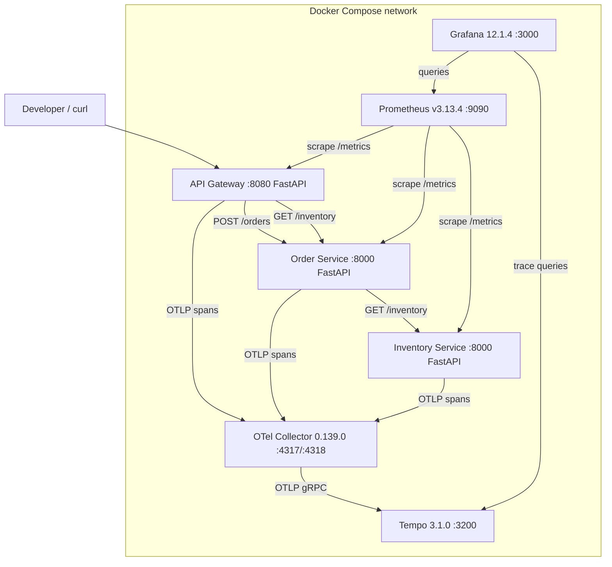

# Architecture

## Responsibilities

- **API Gateway** (`src/traceforge/gateway`): only internet-facing service; validates payloads; orchestrates `POST /api/checkout` and `GET /api/inventory-lookup`.
- **Order Service** (`src/traceforge/orders`): simulates the business operation, calls Inventory; hops exist so traces have real cross-process depth.
- **Inventory Service** (`src/traceforge/inventory`): downstream dependency; hosts the deterministic fault-injection scenarios.
- **Shared core** (`src/traceforge/core`): app factory, config, scenarios, tracing/metrics setup, trace-correlated logging, threshold detector.

## Telemetry flow

1. Client request hits Gateway; FastAPI instrumentation opens a SERVER span.
2. Business spans (`gateway.checkout`, `orders.create`, `inventory.lookup`) add domain context.
3. Outgoing httpx calls (instrumented) inject `traceparent` (W3C) — downstream services join the same trace.
4. Span batches export over OTLP/HTTP to the Collector, which batches and forwards to Tempo over OTLP/gRPC.
5. Prometheus scrapes `/metrics` (prometheus_client, bounded labels) every 5 s.
6. Structured JSON logs on stdout carry `trace_id`/`span_id` for correlation.
